# mini-oled-dock

A minimal, ultra-light, OLED-black floating dock for Windows 11, written in Rust with raw Win32 and no UI framework.

> **About this fork.** The `mini-oled-dock-plus` branch is [gitgiovik/mini-oled-dock](https://github.com/gitgiovik/mini-oled-dock) with its open pull requests #1-#4 merged: Start button and quick-links menu (#1) and window previews (#2) by Desox, the multi-monitor screen choice (#3) and the AppBar position fix with clearer logs (#4). On top of that it adds its own features: the Win key brings the bar to the display under the pointer, a full Start menu written from scratch (all apps, search, its own pins) that opens with a double tap of Win or a left click on the Start button, on any display, and notifications that can be clicked, dismissed and cleared for real. It is not an official release.

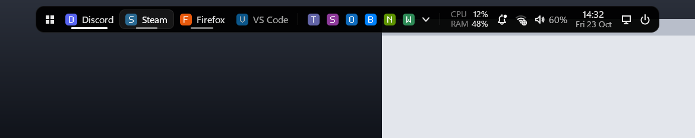

It replaces the native taskbar with a small centred pill that hides when you do not need it. Backgrounds are pure black (OLED pixels switch off), only program names are shown in the bar (window titles appear only in the previews that open when you hover an app with several windows), tray icons of other apps are hosted in the bar, and the popups are drawn by hand. The executable is about 0.7 MB and uses roughly 10 MB of RAM (working set trimmed to under 1 MB while hidden); numbers from the author's machine.

*Screenshots are rendered offscreen by `dock.exe --preview` with mock data.*

| Notifications | Audio | Calendar |
|---|---|---|
|  | 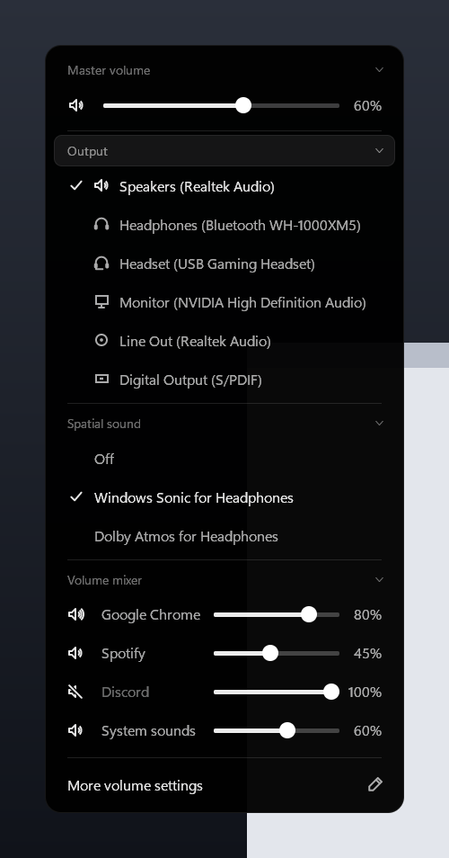 |  |

| Power | Settings | Network |
|---|---|---|
|  | 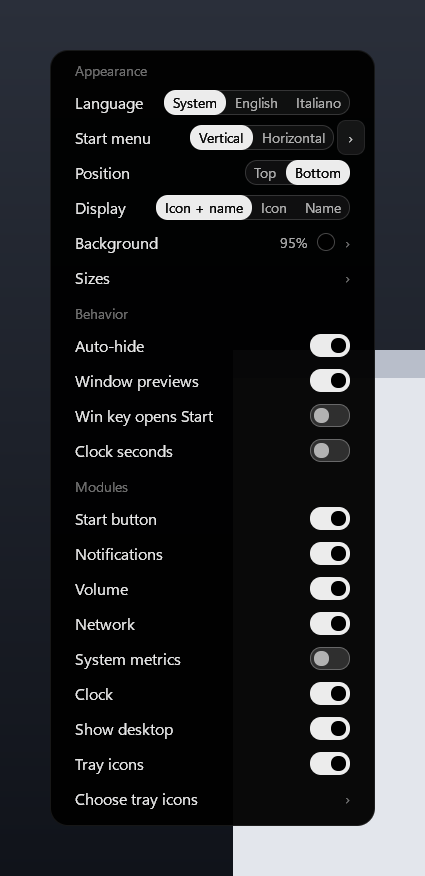 |  |

| Tray: choose visible icons | Start menu |
|---|---|
|  | 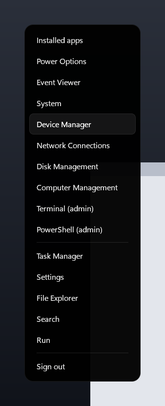 |

| Window previews | Settings: choose the screen |
|---|---|
| 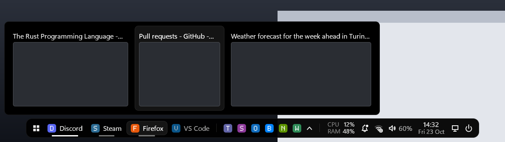 | 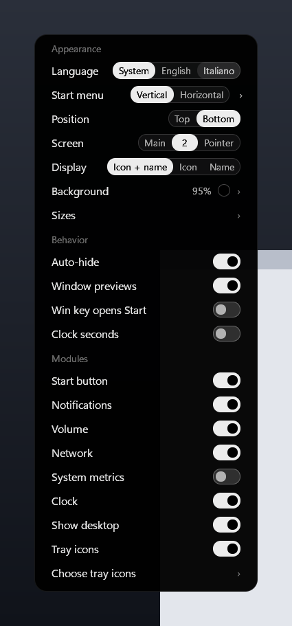 |

New in this fork:

| Start menu (double tap Win) | Start menu: search | Settings: follow the pointer |
|---|---|---|
| 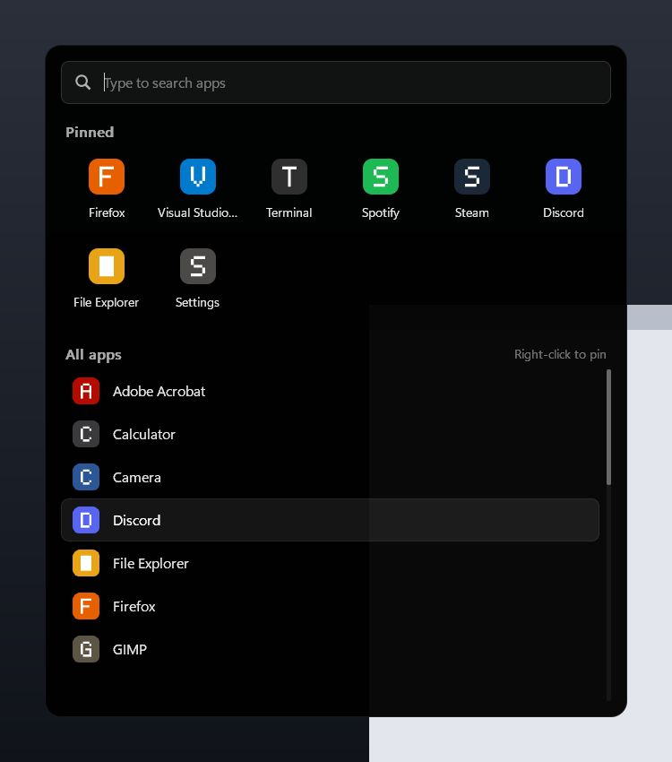 | 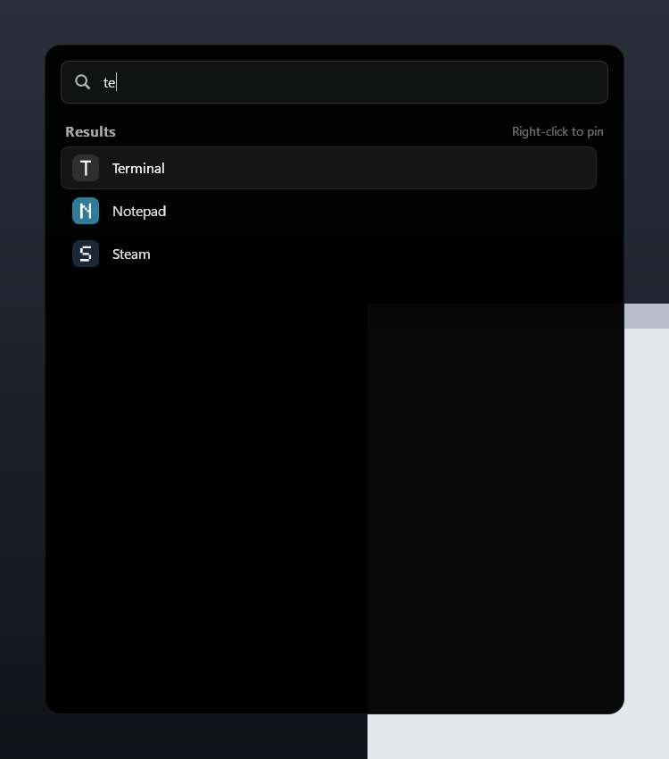 | 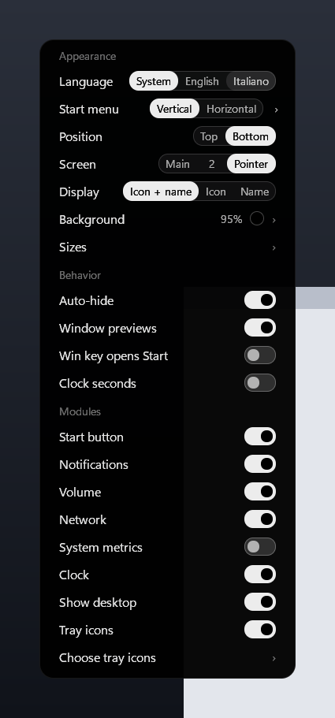 |

New from [Desox's PR #1](https://github.com/Ragnatela666/mini-oled-dock/pull/1) (all optional, off by default):

| Horizontal Start | Horizontal Start: all apps | Horizontal Start: power flyout |
|---|---|---|
| 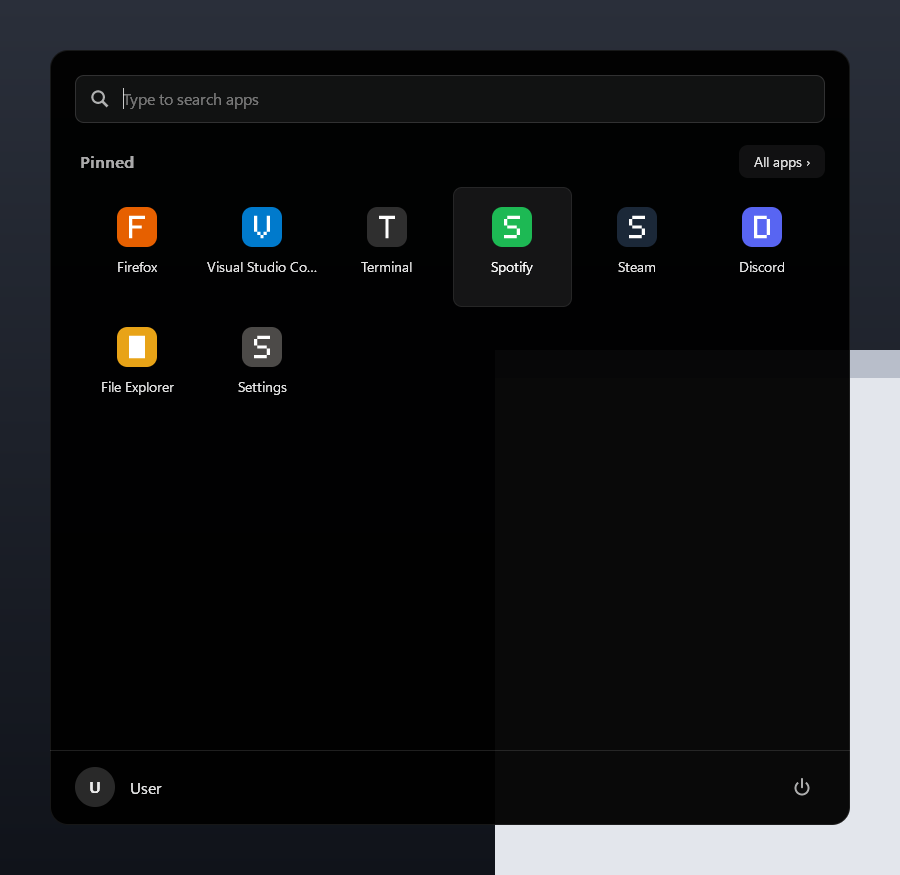 | 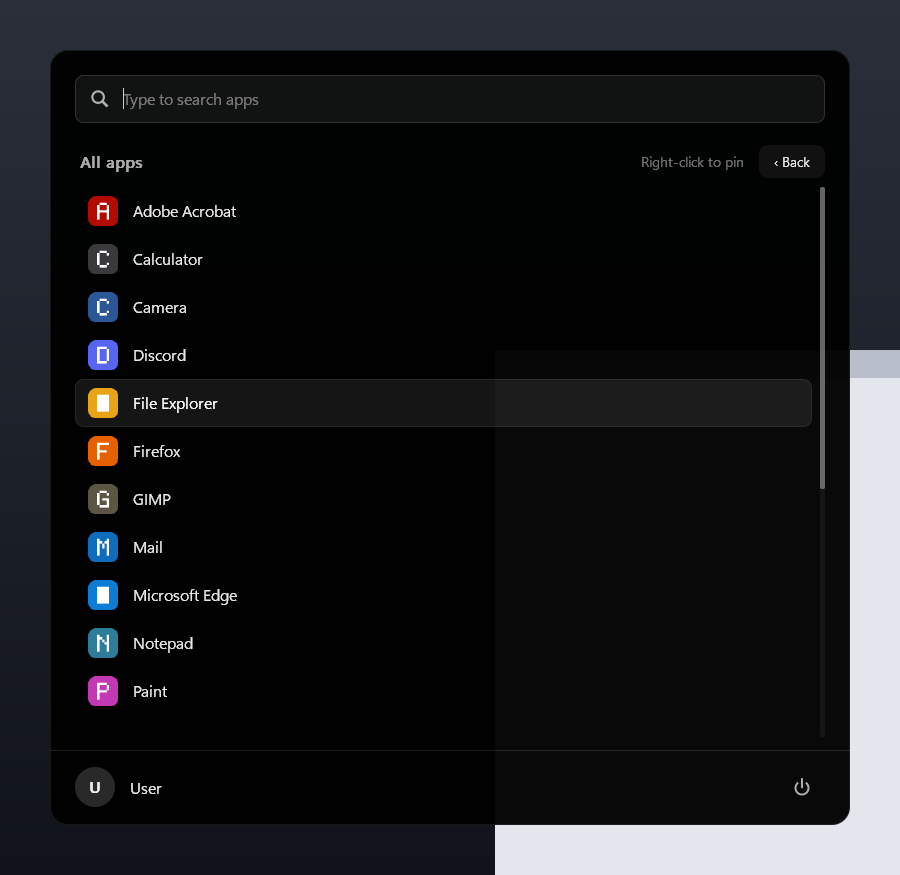 |  |

| Volume: spatial sound and mixer | Volume: customize mode | Settings in Italian |
|---|---|---|
|  | 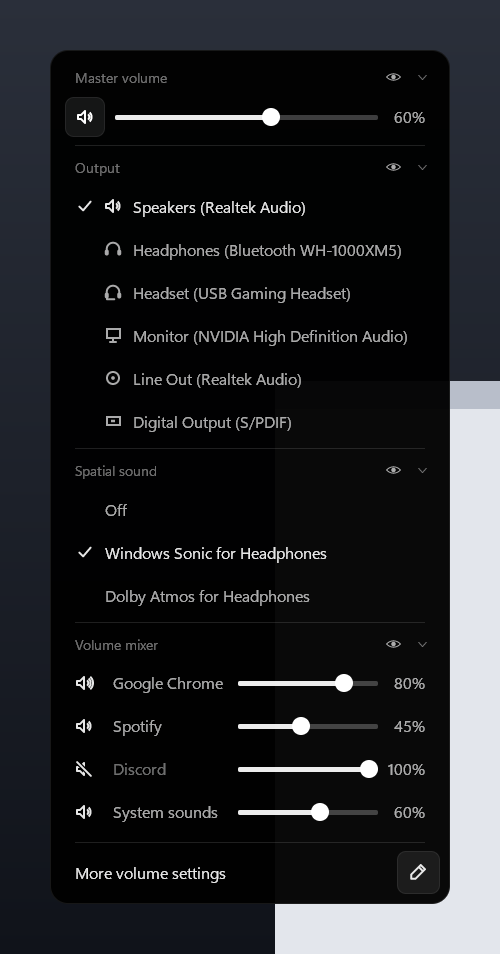 | 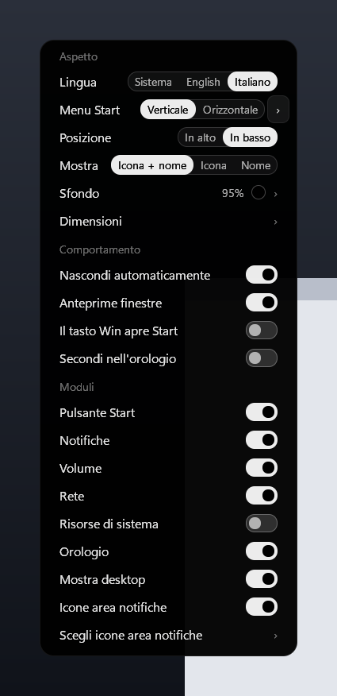 |

| Settings: Start menu (import from Windows) |
|---|
| 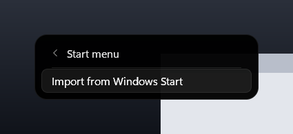 |

## Features

- Centred bar sized to its content: pinned apps first, then open apps. An underline marks open windows (orange when an app asks for attention).
- Display modes: icon + name, icon only, or name only.
- Multi-monitor: the bar can sit on any connected display (Settings → **Screen**: **Main**, the display number, or **Pointer** to follow the mouse) and follows that display's DPI; a display that is disconnected falls back to the primary one.
- Independent sizes for app icons, app names, tray icons and the system modules (the bar height follows the tallest content); background colour from dark presets or any colour through a built-in picker (pure black by default); background opacity from 0 to 100 %.
- **Settings popup** (from the power button): every option above, auto-hide, window previews, clock seconds and the visible modules, applied live.
- Network module: Wi-Fi signal bars or ethernet, with a small globe when the internet is reachable (an x when it is not); click for name, IPv4 and signal.
- System metrics module (off by default): CPU and RAM usage in percent; click opens Task Manager.
- Drag and drop reordering of apps, tray icons and system modules.
- Tray icon hosting, with an overflow popup and a view to choose which icons are visible.
- Popups: notifications (with Do not disturb; click, X and Clear all work, see below), audio (volume, mute, output device), calendar, network, power, settings, and an app menu (new window, pin / unpin, close).
- Window previews: hovering an app with several windows shows live DWM thumbnails with titles; click one to switch; off = no timer, no window.
- Disabled features cost nothing: a hidden module has no timer, no polling and loads no system library; the network and metrics modules are polled only while the bar is visible.
- Show desktop button.
- Start button at the left end of the bar (before the apps): left click opens the dock's Start menu (see below), right click opens a quick-links menu like the native Win+X one (Installed apps, Device Manager, Terminal (admin), PowerShell (admin), Task Manager, Settings, File Explorer, Search, Run, Sign out, ...), in Italian when the Windows display language is Italian and in English otherwise.
- **Win key toggles the dock** (Win+other-key shortcuts still work), including over fullscreen games.
- **Follow the pointer** (fork): with Settings -> Screen -> "Pointer", the Win key brings the bar to the display under the mouse pointer.
- **Start menu on any display** (fork): a quick double tap of the Win key (or a left click on the Start button) opens the dock's own Start menu next to the Start button, on the display under the pointer (the native one only opens on the primary taskbar's display). It lists every app of the native Start menu, classic programs and Store apps alike; type to search (Enter launches the first result, arrows move the selection, Esc clears), and right-click an app to pin it at the top (`start_pins` in the config, separate from the bar pins). Double tap again or Esc to close.
- **Working notifications** (fork): a click on a notification brings the app that sent it to the front (or launches it; if the app cannot be found, the Windows notification centre opens) and removes the notification; **Clear all** and the **X** of a single notification also remove them from Windows' notification history, so they no longer come back.
- **Win key opens Start** (Desox, off by default): one tap of Win opens the dock and the Start menu together in a single animation, the next tap closes both; with auto-hide off the dock stays and Win only toggles Start.
- **Language** (Desox): Settings → Appearance → Language: System (default, follows Windows), English or Italian, applied at once, clock and calendar included.
- **Horizontal Start** (Desox, off by default): Settings → Start menu → Horizontal gives a Windows 11-style layout with search on top, a 6×3 pinned grid with pages, an alphabetical "All apps" list, and a power flyout (Sleep, Lock, Restart, Shut down, Settings, Close dock) inside the menu. Both styles share the same `start_pins`. **Import from Windows Start** copies your Windows pins in the same order (it runs `Export-StartLayout` once, hidden, with a 30 s limit).
- **Spatial sound and volume mixer** (Desox): the volume popup lists the spatial formats really available on the current output (Windows Sonic, Dolby Atmos for Headphones, ...) and one row per app playing audio (up to 8, with mute and slider), plus System sounds.
- **Customizable volume popup** (Desox): each section (Master volume, Output, Spatial sound, Mixer) can be collapsed; the pencil enters Customize mode, where an eye hides or shows a section and dragging its header reorders it. A collapsed or hidden section loads nothing.
- **Fixes** (Desox): tray right-click menus open centred above their icon (G HUB's panel no longer jumps to the top-left corner), apps launched from the dock open in the foreground, and the Win key keeps Start open over fullscreen games that grab the foreground back.
- **Fixes** (VanheXen): the first click on Start (or any bar item that opens a popup) is no longer lost when another app is in front; with Screen → **Pointer**, the screen edge of any display shows the bar there (before, only the Win key moved it); the dock keeps working across Explorer restarts (apps launch again and tray icons come back to the dock within ~2 s); a double tap of Win now slides Start in together with the bar.
- Auto-hide with a slide animation: the bar shows on the Win key or when the pointer touches the screen edge, and hides after 2.5 s.
- Autostart without UAC prompts (scheduled task).
- Watchdog process that always restores the native taskbar.
- Live reload of a commented JSON config.

## Install

**Download:** a ready-built `dock.exe` (with its SHA256) is attached to every [release](https://github.com/Ragnatela666/mini-oled-dock/releases/latest). Run `.\dock.exe --install` from the folder you downloaded it to (see below); to update, do the same with the newer exe. Releases are built and tested by GitHub Actions from the tagged source.

**Build from source:** requires Windows 11 and a stable Rust toolchain (1.87+, MSVC target).

```powershell
git clone https://github.com/Ragnatela666/mini-oled-dock
cd mini-oled-dock
cargo build --release
.\target\release\dock.exe
```

The exe asks for administrator rights (UAC prompt): a non-elevated process cannot manage windows of elevated apps, receive the Win key over them, or fully manage the native taskbar. Apps launched from the dock do NOT inherit the elevated token: they are started through the desktop shell as your normal user (if that is not possible the launch is refused).

To start with Windows (or use the toggle in the power popup):

```powershell
.\target\release\dock.exe --install     # copies the exe to %ProgramFiles%\mini-oled-dock and registers a logon task
.\target\release\dock.exe --uninstall   # removes the logon task
```

The logon task runs the dock elevated, so the installed copy lives in an admin-only folder (`%ProgramFiles%\mini-oled-dock\dock.exe`, inheriting the Program Files permissions) that normal programs cannot modify. Its data lives in `%ProgramData%\mini-oled-dock` (see [Data folder](#data-folder)).

**Update:** run `--install` again after rebuilding; if the installed dock is running it is asked to exit and restarted from the new copy. If you installed an older version, an old copy may be left in `%LOCALAPPDATA%\Dock\bin`: `--install` reports it but does not delete it (an elevated delete in a user-writable folder is unsafe), so delete that folder yourself once the old dock has exited.

**Uninstall:** `--uninstall` removes the logon task but keeps `%ProgramFiles%\mini-oled-dock` (it may be the copy currently running). Delete that folder from an elevated prompt if you no longer need it, and `%ProgramData%\mini-oled-dock` (also elevated) to remove your settings, logs and icons.

## Usage

- **Show / hide:** Win key alone, or the screen edge. With Settings → Screen → **Pointer** the Win key brings the bar to the display under the pointer (if the bar is visible on another display it moves there instead of hiding).
- **Start menu:** double tap the Win key (second tap within 300 ms; the first tap is not delayed) or left click the Start button. Type to search, Enter launches the first result, arrows and the wheel scroll, right click pins / unpins an app, Esc clears the search and then closes. Right click on the Start button still opens the quick-links menu.
- **Notifications:** click one to switch to its app, X removes it, **Clear all** empties the list and the Windows history.
- **App entries:** left click activates, minimises or cycles windows; middle click starts a new instance; right click opens the app menu; resting the pointer on an app with several windows shows a preview of each (click one to switch to it).
- **Volume:** wheel changes it, middle click mutes, left click opens the audio popup (output, spatial sound, per-app mixer). Click a section header to collapse it; the pencil at the bottom enters Customize mode (eye = hide / show, drag a header to reorder).
- **Network:** left click opens the network popup (connection, internet, IPv4, signal, "Network settings"); right click opens Windows' network settings.
- **System metrics:** click opens Task Manager.
- **Settings:** power button, then **Settings**: position, screen (with two or more displays: **Main**, the display number or **Pointer**), display mode, auto-hide, window previews, clock seconds, one switch per module, **Choose tray icons** (which tray icons stay in the bar) and two sub-pages:
  - **Background ›**: seven dark presets (Black, Graphite, Slate, Navy, Plum, Wine, Forest) and a custom swatch that opens a colour picker (saturation/value square, hue strip, preview and hex code; drag to pick), plus the **Opacity** slider (0-100 %, background only: at 0 % only text and icons are visible and the bar still reacts to the mouse).
  - **Sizes ›**: sliders for app icons, app names, tray icons and modules, and **Reset sizes**.

  Sliders follow a drag or a click on the track, and the mouse wheel (opacity and modules in steps of 5 %, the others 1 px). Every change applies at once and is saved to `config.json` (the comments are kept); while you drag, the file is written when you release the button.
- **Exit:** `Ctrl+Alt+Q`, or the power popup, or `dock.exe --restore`.

## Configuration

`%ProgramData%\mini-oled-dock\config.json` is created on first start as commented JSON (`//` and `/* */` allowed) with a guide above every option. It reloads automatically within about 2 s. Missing fields take their default; on a syntax error the previous settings are kept and the error is logged.

**Editing by hand:** open it with Notepad (no admin rights needed). Notepad saves in place, which is allowed; editors that save by writing a new file and renaming it over the old one (many code editors do) cannot save here, so use Notepad or run your editor elevated. If a programmatic save happens while your edit has a syntax error, your version is first copied to `config.json.bak` next to it.

| Option | Default | Meaning |
|---|---|---|
| `position` | `"bottom"` | `"top"` or `"bottom"` |
| `monitor` | `""` | Display the bar sits on: `""` = primary monitor, or a device name such as `"\\\\.\\DISPLAY2"`. A display that is not connected falls back to the primary one. `"pointer"` = the Win key brings the bar to the display under the mouse pointer |
| `display_mode` | `"icon_text"` | `"icon_text"`, `"icon"` or `"text"` |
| `app_icon_size` | `16` | App icon size in logical px, 14-32 |
| `app_text_size` | `13` | App name text size in logical px, 10-18 |
| `tray_icon_size` | `16` | Tray icon size in logical px, 12-24 |
| `module_size` | `100` | Scale of the Start button and the system modules (notifications, volume, network, metrics, clock, show desktop, power) in percent, 75-150 |
| `background` | `"#000000"` | Background colour of the bar and the popups, `"#RRGGBB"` (the old values `"black"` and `"dark"` are still accepted) |
| `bar_opacity` | `95` | Bar background opacity in percent, 0-100 (text and icons stay opaque) |
| `autohide` | `true` | Hide the bar when the pointer leaves it |
| `window_previews` | `true` | Live previews of an app's windows when the pointer rests on an app with two or more |
| `hide_native_taskbar` | `true` | Hide the Windows taskbar while the dock runs |
| `show_date` / `date_format` | `true` / `"ddd d MMM"` | Date under the time (Windows date picture) |
| `time_format` / `show_seconds` | `"HH:mm"` / `false` | Clock format (Windows time picture) |
| `show_volume_percent` | `true` | Show `NN%` next to the speaker |
| `show_tray` | `true` | Host other apps' tray icons (switching it off stops the tray host; the icons go back to Explorer) |
| `show_network` | `true` | Network module: Wi-Fi bars / ethernet, internet badge, details popup |
| `show_metrics` | `false` | CPU / RAM usage module (click opens Task Manager) |
| `show_notifications` / `show_volume` / `show_clock` / `show_desktop_button` | `true` | Show the other system modules (a hidden module costs nothing) |
| `show_start_button` | `true` | Start button at the left end of the bar (a fixed item, not a movable module) |
| `pinned` | `[]` | Pinned apps, in display order |
| `start_pins` | `[]` | Apps pinned at the top of the dock's Start menu (separate from `pinned`; right click an app in the menu to add or remove it) |
| `names` | `{}` | Display-name overrides (key: lowercase exe name or AUMID) |
| `language` | `"auto"` | Dock language: `"auto"` (Windows display language), `"en"` or `"it"` |
| `win_opens_start` | `false` | One tap of Win opens the dock and the Start menu together |
| `start_style` | `"vertical"` | Start menu layout: `"vertical"` or `"horizontal"` |
| `audio_layout` | `"MOSX"` | Volume popup sections in order (M master, O output, S spatial, X mixer; lowercase = collapsed, `-` in front = hidden); normally set from the popup |

The bar height follows the tallest content; the defaults give the original 36 px bar. An old `bar_size` value (`"small"`, `"medium"`, `"large"`) is converted once into the four sizes.

Tray visibility and ordering (`tray_hidden`, `app_order`, `tray_order`, `modules_order`) are written by the dock itself.

**Tray icons of elevated apps.** The dock runs as administrator, so by default it refuses to send click, hover and menu messages to a tray icon whose window belongs to another elevated program: otherwise any normal program could register a fake icon pointing at an elevated window and use the dock to deliver messages Windows would block (a UIPI bypass). This opt-in is deliberately not in `config.json` (any program running as you can write that file); it is an admin-only registry value. To enable it, from an elevated PowerShell:

```powershell
New-Item -Path HKLM:\SOFTWARE\mini-oled-dock -Force; Set-ItemProperty HKLM:\SOFTWARE\mini-oled-dock TrustElevatedTrayIcons 1 -Type DWord
```

It is picked up within about 10 s. Set it to `0` or delete the key to turn it off. System messages (below `WM_USER`) are never forwarded to elevated windows either way.

A pinned app looks like this; `launch` is an exe path or `shell:AppsFolder\<AUMID>` (list AUMIDs with `Get-StartApps`), `icon` is an optional PNG in `%ProgramData%\mini-oled-dock\icons\` (you can drop files there without admin rights; at most 4 MB, no shortcuts, links or hard links), given as a plain file name only (paths, `..`, drive letters and UNC paths are rejected). Pinning from the right-click menu fills it in for you. Apps are always started without administrator rights, through the desktop shell, even though the dock itself is elevated; if that is not possible the launch is refused rather than run elevated. The two admin entries of the Start quick-links menu (Terminal and PowerShell) ask Explorer to start them with the `runas` verb, so they go through the normal UAC prompt; the dock never uses its own token.

```jsonc
{ "key": "c:\\program files\\discord\\discord.exe", "name": "Discord",
  "launch": "C:\\Program Files\\Discord\\Discord.exe", "icon": "discord.png" }
```

Run `dock.exe --list-apps` to see how each open window was named. Command-line flags (`--top`, `--bottom`, `--no-autohide`, `--keep-taskbar`, ...) override the config; `dock.exe --help` lists them all.

## Recovering the taskbar

The dock saves the original taskbar state before hiding it, and a separate watchdog process restores it if the dock crashes or hangs. If something still goes wrong:

1. Run `dock.exe --restore` from any terminal. It works even when no dock is running.
2. If the taskbar is still hidden, restart Explorer:

```powershell
Stop-Process -Name explorer -Force; Start-Process explorer
```

## Limitations

- One bar, on one display at a time (the primary monitor unless another is chosen in Settings, or the display under the pointer with **Pointer**); the dock does not reserve work area, so maximised windows go under the bar.
- The notification list needs Windows notification access (asked once). Windows does not let an unpackaged app activate or dismiss another app's notification directly: a click on a notification brings up the app that sent it (its window, or a launch), and Clear all / X go through each app's notification history. Switching the audio output and Do not disturb use undocumented COM interfaces that a Windows update could break.
- Tray hosting only works while the native taskbar is hidden.
- Developed and tested on Windows 11 only.

## Data folder

Everything the dock stores is in `%ProgramData%\mini-oled-dock`:

| Path | What | Who can write |
|---|---|---|
| `config.json` (+ `config.json.bak`) | settings | you (edit in place) and administrators; the `.bak` copy is admin-only |
| `icons\` | your custom PNGs | you can add, replace and delete files |
| `cache\` | extracted icon cache (PNG) | administrators only |
| `dock.log`, `dock.log.1` | log, rotated at 2 MB | administrators only |
| `taskbar-state` | the original taskbar state, used to restore it | administrators only |

The dock runs elevated, so its data must not live where normal programs can plant links: an elevated write, rename or delete that follows a junction or hard link planted in a user-writable folder (such as the old `%LOCALAPPDATA%\Dock`) can be turned into an arbitrary file write or delete. The folder is therefore created by the elevated dock with its own protected permissions (administrators and SYSTEM full control, users read only); only `config.json` (read and write its content, not delete or rename it) and `icons\` (add files) are opened up for you, and custom icons are read with checks that refuse links and anything outside that folder. If the folder exists but was not created by an administrator (or is a link), the dock renames it away or, failing that, refuses it and runs without saving anything; the log (or DebugView, when there is no log) says to delete it from an elevated prompt.

**Upgrading from an older version:** on the first start the old `%LOCALAPPDATA%\Dock\config.json` is read once and saved in the new folder. Custom icons are not copied: move your PNGs from `%LOCALAPPDATA%\Dock\icons` to `%ProgramData%\mini-oled-dock\icons` yourself, then delete `%LOCALAPPDATA%\Dock` (the dock never writes or deletes anything there).

## Build notes

To render the screenshots, build with `DOCK_NO_MANIFEST=1` (a non-elevated manifest) and run `dock.exe --preview <folder>`.

## Credits and license

A few Windows shell protocol structures in `src/tray_host.rs` are adapted from [lightbar](https://github.com/SauerExe/lightbar) (MIT); see [THIRD_PARTY_NOTICES.md](THIRD_PARTY_NOTICES.md). Other shell projects were studied for protocol knowledge only; no AGPL code was copied.

Huge thanks to [Desox](https://github.com/Desox96) for the excellent work on this project: the Start button, quick-links menu and window previews (PRs #1 and #2 upstream), and in this fork the tray menu placement and foreground fixes, Win opening Start, the IT/EN language switch, spatial audio and the per-app mixer, the customizable volume popup and the horizontal Start layout ([PR #1](https://github.com/Ragnatela666/mini-oled-dock/pull/1)). Clean, well-split, carefully tested contributions.

Many thanks also to [VanheXen](https://github.com/VanheXen) for tracking down and fixing the lost first click on Start and the other popups when another app had the foreground ([PR #2](https://github.com/Ragnatela666/mini-oled-dock/pull/2)): a precise diagnosis from the logs and a one-line fix. And for 1.3.0: the multi-monitor edge fix ([PR #3](https://github.com/Ragnatela666/mini-oled-dock/pull/3)), the big de-duplication refactor that removed over 500 lines with byte-identical rendering ([PR #4](https://github.com/Ragnatela666/mini-oled-dock/pull/4)), and the careful investigation that kept the dock working across Explorer restarts ([PR #5](https://github.com/Ragnatela666/mini-oled-dock/pull/5)).

[MIT](LICENSE) &copy; 2026 gitgiovik
